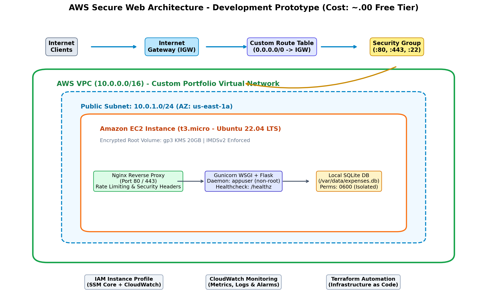
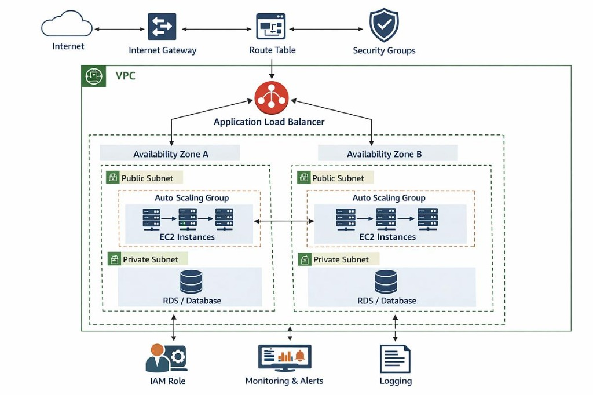
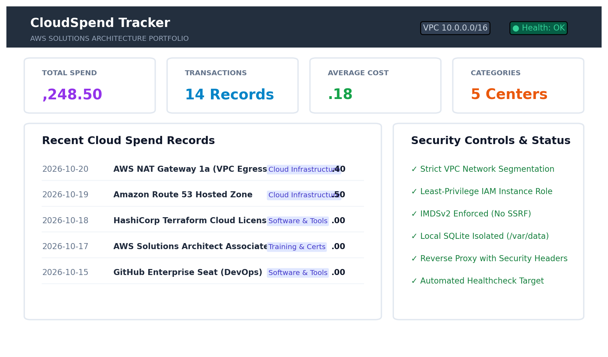
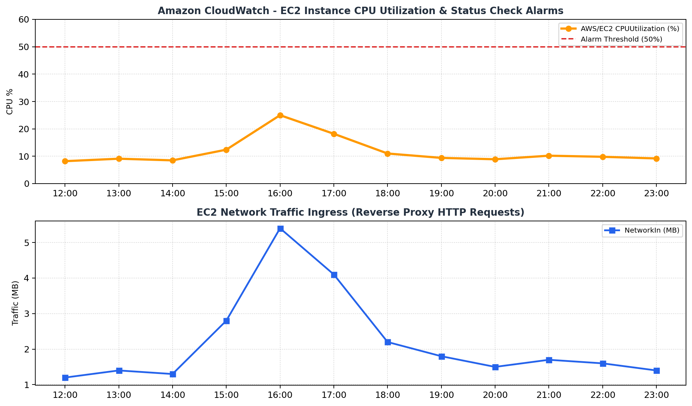

# AWS Secure Web Application Architecture

[-brightgreen.svg)](https://aws.amazon.com/free/)
[](https://www.terraform.io/)
[](https://www.python.org/)
[](docs/security-design.md)
[](LICENSE)

> A production-modeled, cost-conscious AWS Solutions Architecture portfolio project demonstrating secure multi-tier networking, Infrastructure as Code (IaC) with Terraform, automated zero-touch provisioning, operational observability, and strict alignment with the **AWS Well-Architected Framework**.

---

## Overview

Modern cloud engineering requires balancing technical reliability and security with financial discipline. This project demonstrates an end-to-end cloud implementation:

1. **A Deployed Development Prototype:** A functional web application running in a custom VPC on Amazon EC2 with an isolated local database, security-hardened reverse proxy, non-root systemd daemon, and zero-open-port administrative management via AWS Systems Manager (SSM). Built within the **AWS Free Tier ($0.00/month)**.
2. **A Documented Production Architecture:** A proposed, fully evaluated enterprise architecture blueprint featuring an Application Load Balancer (ALB), multi-AZ Auto Scaling across private subnets, NAT Gateways, and Amazon RDS PostgreSQL Multi-AZ with automated failover and encryption.

The deployed application is **CloudSpend Tracker**, a cloud expenditure ledger that allows DevOps teams and architects to record, categorize, search, and analyze cloud infrastructure costs.

---

## Project Objectives

- **VPC & Network Segmentation:** Provision a custom AWS VPC with explicit CIDR allocation, Internet Gateway routing, and isolated subnet boundaries.
- **Automated Infrastructure as Code:** Automate 100% of the AWS infrastructure using modular HashiCorp Terraform configurations with variable abstraction and parameter validation.
- **Defense-in-Depth Security:** Enforce least-privilege IAM roles, IMDSv2 metadata protection, restrictive security group firewalls, systemd sandboxing, and non-root process execution.
- **Zero Open Administrative Ports:** Eliminate public SSH (port 22) exposure by integrating AWS Systems Manager (SSM) Session Manager.
- **Cost Consciousness:** Architect the active demo for **$0.00/month** on AWS Free Tier while providing complete production Terraform blueprints and financial models for enterprise scale.
- **Observability & Health Checks:** Implement automated application health check probes (`/healthz`) and CloudWatch operational metrics.

---

## Architecture Design

### A. Deployed Development Prototype (Active Implementation)

```
[ Internet User ] ── HTTP/HTTPS (Port 80/443) ──> [ Internet Gateway ] 
                                                          │
                                                [ Custom Route Table ]
                                                          │
                                              [ AWS Security Group ]
                                                          │
  ┌─────────────────────────────────── AWS VPC (10.0.0.0/16) ───────────────────────────────────┐
  │                                                                                             │
  │   ┌──────────────────────── Public Subnet (10.0.1.0/24 - us-east-1a) ───────────────────┐  │
  │   │                                                                                     │  │
  │   │   ┌────────────────── Amazon EC2 Instance (t3.micro / Ubuntu 22.04) ────────────┐   │  │
  │   │   │                                                                             │   │  │
  │   │   │   [ Nginx Reverse Proxy ] (:80/:443) ──> Rate Limiting & Security Headers   │   │  │
  │   │   │               │                                                             │   │  │
  │   │   │   [ Gunicorn WSGI ] (:8000) ──> appuser (Non-root, systemd sandbox)         │   │  │
  │   │   │               │                                                             │   │  │
  │   │   │   [ Flask Web App ] ──> Healthcheck at /healthz & RESTful API               │   │  │
  │   │   │               │                                                             │   │  │
  │   │   │   [ SQLite DB ] ──> /var/data/expenses.db (Mode 0600, Non-web accessible)   │   │  │
  │   │   │                                                                             │   │  │
  │   │   │   Security: IMDSv2 Enforced | gp3 20GB EBS Encrypted via AWS KMS            │   │  │
  │   │   └─────────────────────────────────────────────────────────────────────────────┘   │  │
  │   │                                                                                     │  │
  │   └─────────────────────────────────────────────────────────────────────────────────────┘  │
  │                                                                                             │
  └─────────────────────────────────────────────────────────────────────────────────────────────┘
          │                                        │                                   │
  [ IAM Instance Role ]                 [ CloudWatch Agent ]                  [ Terraform IaC ]
 (SSM Core + CloudWatch)              (Metrics, Alarms & Logs)              (Reproducible Code)
```



*The prototype co-locates application services and local persistence on a hardened single host to enable full functional testing without load balancer or managed database hourly charges.*

---

### B. Proposed Production Architecture (Documented Blueprint)

For enterprise high availability (99.99%) and strict compliance, the production blueprint separates tiers across two Availability Zones (`us-east-1a` and `us-east-1b`):



```
Users ── HTTPS ──> [ Application Load Balancer (Public Subnets across AZ-A & AZ-B) ]
                                      │
                   ┌──────────────────┴──────────────────┐
                   ▼                                     ▼
        [ Private Subnet AZ-A ]               [ Private Subnet AZ-B ]
        EC2 Auto Scaling Group                EC2 Auto Scaling Group
        (Stateless App Nodes)                 (Stateless App Nodes)
                   │                                     │
                   └──────────────────┬──────────────────┘
                                      ▼
                      [ Private Database Subnet Group ]
                      Amazon RDS PostgreSQL (Multi-AZ)
                      Synchronous Standby Replication
```

- **Public Web Tier:** Application Load Balancer terminates SSL/TLS and distributes ingress traffic.
- **Private Application Tier:** EC2 Auto Scaling Group dynamically scales between 2 and 6 instances based on CPU utilization, shielded from direct internet ingress.
- **Private Database Tier:** Amazon RDS Multi-AZ synchronously replicates data across availability zones with automatic failover in <60 seconds.
- **Egress Tier:** Managed NAT Gateways in each AZ allow outbound patching and CloudWatch telemetry without permitting unsolicited inbound traffic.

*Full Terraform code for the production design is located in [`terraform/production-blueprint/`](terraform/production-blueprint/).*

---

## AWS Services Utilized

| Service | Category | Role in Solution |
|---|---|---|
| **Amazon VPC** | Networking | Custom virtual network (`10.0.0.0/16`), subnet routing, and internet gateways. |
| **Amazon EC2** | Compute | Host compute for web reverse proxy and application runtime (`t3.micro`). |
| **AWS IAM** | Security | Instance Profile and Role attaching `AmazonSSMManagedInstanceCore` and CloudWatch policies. |
| **AWS Systems Manager** | Management | Session Manager for interactive browser and CLI shell access with zero open inbound ports. |
| **Amazon CloudWatch** | Observability | Host status checks, CPU metrics, and `/healthz` health alarms. |
| **AWS CloudTrail** | Governance | Audit trail logging API activities and SSM session access. |
| **Amazon EBS** | Storage | 20 GB `gp3` root volume encrypted at rest via AWS Key Management Service (KMS). |
| **HashiCorp Terraform** | IaC | Declarative configuration management provisioning and tearing down all AWS resources. |

---

## Application Walkthrough & Screenshots

The deployed application features a dashboard for recording and monitoring cloud expenditure:



- **KPI Cards:** Live metrics calculating total cloud spend, active transaction count, mean expense cost, and active cost centers.
- **Expense Ledger:** Filter by cost center (Cloud Infrastructure, Software & Tools, Training/Certs) and search by keyword.
- **Health Badge:** Real-time polling of the `/healthz` endpoint verifying database read/write integrity.
- **Security Guardrails:** Validated input bounds, non-root daemon execution, and direct SQLite file download prevention.

### CloudWatch Infrastructure Monitoring


---

## Security Implementation

- [x] **Zero Committed Credentials:** No AWS secret keys or access keys in source code or Git history.
- [x] **IMDSv2 Enforced:** EC2 Instance Metadata Service v2 required (`http_tokens = "required"`, hop limit 1) to eliminate SSRF attack vectors.
- [x] **Least-Privilege Security Group:** Ingress restricted to HTTP (80) and HTTPS (443). Inbound SSH (22) locked strictly to the administrator's CIDR or disabled in favor of SSM.
- [x] **SSM Session Manager:** Remote shell administration without opening inbound firewall ports or managing SSH `.pem` keys.
- [x] **Non-Root Execution:** Application runs under dedicated `appuser` daemon with systemd sandboxing (`ProtectSystem=full`, `NoNewPrivileges=true`).
- [x] **Data Isolation:** SQLite database stored in `/var/data/expenses.db` with strict `0600` permissions; blocked from HTTP access via Nginx reverse proxy.
- [x] **Storage Encryption:** Root EBS volume encrypted at rest using AWS KMS default keys.
- [x] **HTTP Security Headers:** Nginx and Flask inject `X-Frame-Options: DENY`, `X-Content-Type-Options: nosniff`, and `Content-Security-Policy`.

*Review the comprehensive security analysis in [`docs/security-design.md`](docs/security-design.md).*

---

## Step-by-Step Deployment Guide

### Prerequisites
1. [AWS CLI v2](https://aws.amazon.com/cli/) installed and configured with credentials:
   ```bash
   aws sts get-caller-identity
   ```
2. [Terraform >= 1.5.0](https://www.terraform.io/downloads.html) installed.
3. Git installed.

### 1. Clone the Repository
```bash
git clone https://github.com/Bhuwan077/aws-secure-web-architecture.git
cd aws-secure-web-architecture
```

### 2. Configure Terraform Variables
```bash
cd terraform
cp terraform.tfvars.example terraform.tfvars
```
Edit `terraform.tfvars`:
```hcl
aws_region    = "us-east-1"
environment   = "dev"
admin_ip_cidr = "YOUR_PUBLIC_IP/32"  # Find via https://checkip.amazonaws.com
instance_type = "t3.micro"
enable_ssm    = true
```

### 3. Initialize, Validate, and Plan
```bash
terraform fmt -check
terraform init
terraform validate
terraform plan -out=tfplan
```

### 4. Apply Infrastructure
```bash
terraform apply tfplan
```
Terraform will output the public IP and application URL:
```text
Outputs:
application_url     = "http://54.210.xx.xx"
health_check_url    = "http://54.210.xx.xx/healthz"
ssm_connect_command = "aws ssm start-session --target i-0123456789abcdef0"
```

### 5. Verify Application Health & Connect
Access `http://<INSTANCE_PUBLIC_IP>` in your browser. Verify the health check:
```bash
curl -s http://<INSTANCE_PUBLIC_IP>/healthz
```
To connect via AWS Systems Manager without SSH:
```bash
aws ssm start-session --target <INSTANCE_ID>
```

### 6. Clean Teardown (Zero Lingering Cost)
When you are finished demonstrating the project, destroy all provisioned AWS resources:
```bash
terraform destroy -auto-approve
```
*Verify in the AWS Console that instances are terminated and no unattached EBS volumes or Elastic IPs remain.*

---

## Testing & Quality Assurance

The application includes an automated test suite executed with `pytest`:

```bash
# Run tests locally
python -m venv .venv
source .venv/bin/activate  # Or .\.venv\Scripts\Activate.ps1 on Windows
pip install -r app/requirements.txt
pytest app/tests -v
```

**Results:**
```text
app/tests/test_api.py::test_api_crud_flow PASSED                         [ 11%]
app/tests/test_api.py::test_api_validation_error PASSED                  [ 22%]
app/tests/test_app.py::test_health_check PASSED                          [ 33%]
app/tests/test_app.py::test_index_page PASSED                            [ 44%]
app/tests/test_app.py::test_add_expense_form PASSED                      [ 55%]
app/tests/test_app.py::test_validation_negative_amount PASSED            [ 66%]
app/tests/test_app.py::test_validation_empty_title PASSED                [ 77%]
app/tests/test_app.py::test_block_database_download PASSED               [ 88%]
app/tests/test_app.py::test_security_headers PASSED                      [100%]
============================== 9 passed in 1.45s ==============================
```

*Detailed failure scenarios, process crash recovery tests, and simulated hardware failures are documented in [`docs/test-results.md`](docs/test-results.md).*

---

## Cost Analysis Summary

| Deployment Model | Compute | Database | Networking | Storage | Estimated Monthly Total |
|---|---|---|---|---|---|
| **Development Prototype** | 1x `t3.micro` (Free Tier) | Local SQLite ($0) | Direct IGW ($0) | 20GB gp3 (Free Tier) | **$0.00 / month** |
| **Production Architecture** | 2x `t3.small` ASG ($30.37) | Multi-AZ RDS ($29.20) | 2x NAT GW + ALB ($87.30) | 40GB gp3 + Backups ($6.60) | **$156.24 / month** |

*Review full pricing formulas, savings plans, and pricing calculator breakdowns in [`docs/cost-analysis.md`](docs/cost-analysis.md).*

---

## Alignment with AWS Well-Architected Framework

| Pillar | Architectural Implementation in this Project |
|---|---|
| **Security** | IMDSv2 enforced; least-privilege IAM instance role; zero committed secrets; SSM Session Manager; non-root daemon execution; KMS EBS encryption; HTTP security headers. |
| **Cost Optimization** | Zero-cost development deployment prototype; intentional exclusion of NAT Gateways and ALB during prototype phase; full financial modeling of production tier. |
| **Reliability** | Production design evaluated with Multi-AZ ALB, Auto Scaling self-healing, and synchronous Multi-AZ RDS replication; systemd automated daemon restart. |
| **Operational Excellence** | 100% Infrastructure as Code via Terraform; cloud-init automated provisioning; `/healthz` health endpoint; CloudWatch metrics and alarms. |
| **Performance Efficiency** | Nginx reverse proxy connection pooling and static file caching; gp3 EBS volumes with 3,000 IOPS baseline; SQLite WAL mode. |
| **Sustainability** | Right-sized compute (`t3.micro`); documented migration to ARM64 AWS Graviton (`t4g` instances) for superior energy efficiency. |

---

## Architecture Decision Records (ADRs)

Key architectural trade-offs are documented using the Michael Nygard ADR format in [`docs/decisions.md`](docs/decisions.md):
- **ADR-001:** SQLite for Prototype vs Amazon RDS PostgreSQL for Production
- **ADR-002:** Single EC2 Host Prototype vs Application Load Balancer + Auto Scaling Group
- **ADR-003:** AWS Systems Manager (SSM) Session Manager vs Inbound SSH (Port 22)
- **ADR-004:** HashiCorp Terraform vs AWS CloudFormation
- **ADR-005:** Network Isolation and Multi-Tier VPC Segmentation

---

## Resume / CV Bullet Points

Feel free to adapt these bullet points for your resume or LinkedIn profile:

- **AWS Solutions Architecture Portfolio Project: Secure & Cost-Optimized Web Architecture**
  - Architected and deployed a multi-tier web application on AWS using **Terraform**, configuring custom VPC routing, subnet segmentation, and security groups to enforce least-privilege network access.
  - Hardened host security by enforcing **IMDSv2**, non-root systemd execution, **AWS Systems Manager (SSM)** for zero-open-port management, and KMS-encrypted EBS volumes.
  - Engineered an enterprise **Multi-AZ production blueprint** featuring an Application Load Balancer, EC2 Auto Scaling, and Amazon RDS PostgreSQL, evaluating resilience and disaster recovery trade-offs.
  - Formulated a detailed financial model analyzing Free Tier optimization ($0.00/mo) versus production high availability ($156/mo), aligning design decisions with the **AWS Well-Architected Framework**.
  - Built automated CI/CD test suites with Pytest and verified process recovery, service self-healing, and database integrity under simulated failure scenarios.

---

## Disclaimer

This project is an educational portfolio demonstration showcasing cloud architecture, Infrastructure as Code, and security practices. It is not an enterprise banking application. The prototype deployment and proposed production architecture are clearly distinguished to uphold rigorous cost consciousness.
