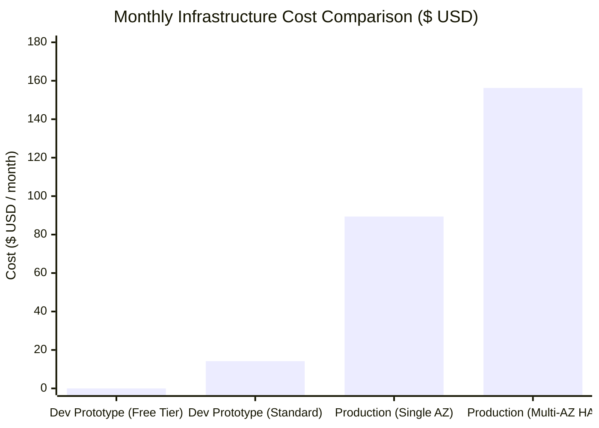

# Cloud Cost Analysis & Financial Modeling

**Project:** AWS Secure Web Application  
**Framework Pillar:** AWS Well-Architected Framework - Cost Optimization  
**Region Evaluated:** `us-east-1` (N. Virginia)

---

## 1. Executive Summary

A defining attribute of an AWS Solutions Architect is the ability to balance technical excellence with financial stewardship. 

This document contrasts the **financial model** of our deployed Development Prototype against the proposed Multi-AZ Production Architecture, detailing how we maintain a **\$0.00/month** portfolio expenditure while architecting an enterprise-ready system.



---

## 2. Deployed Development Prototype Financial Model

The prototype is engineered specifically to maximize AWS Free Tier allowances.

| Resource Component | Specification | Free Tier Allowance | Unit Price | Projected Monthly Bill |
|---|---|---|---|---|
| **Amazon EC2** | 1x `t3.micro` (2 vCPU, 1 GiB RAM) | 750 hrs/month | \$0.0104 / hr | **\$0.00** |
| **Amazon EBS Storage** | 20 GB gp3 root volume | 30 GB/month | \$0.08 / GB-mo | **\$0.00** |
| **Public IPv4 Address** | 1x associated with running EC2 | 750 hrs/month (Free Tier) | \$0.005 / hr | **\$0.00** |
| **AWS VPC & Subnet** | Dedicated 10.0.0.0/16 | Always Free | \$0.00 | **\$0.00** |
| **Internet Gateway** | 1x Attached IGW | Always Free | \$0.00 | **\$0.00** |
| **NAT Gateway** | *Excluded by Design* | None | \$0.045 / hr | **\$0.00** |
| **Application Load Balancer** | *Excluded by Design* | None | \$0.0225 / hr | **\$0.00** |
| **Amazon RDS Database** | *Excluded (Local SQLite)* | 750 hrs db.t3.micro | Variable | **\$0.00** |
| **AWS Systems Manager** | Session Manager Interactive Shell | Always Free | \$0.00 | **\$0.00** |
| **Total Prototype Monthly Cost** | | | | **\$0.00 / month** |

> [!NOTE]
> If deployed in an AWS account where the 12-month Free Tier has expired, the prototype costs approximately **\$14.20/month** (\$7.59 EC2 + \$1.60 EBS + \$3.65 public IPv4 + \$1.36 data transfer). Stopping the instance when not actively being reviewed reduces this cost to **<\$2.00/month** (storage only).

---

## 3. Production Architecture Financial Model (Enterprise HA)

The production architecture separates tiers across Availability Zones (`us-east-1a`, `us-east-1b`) for 99.99% availability.

| Service Tier | Resource Configuration | Monthly Hours | Monthly Cost (USD) | Architectural Justification |
|---|---|---|---|---|
| **Application Ingress** | 1x Application Load Balancer + 1 LCU | 730 hrs | **\$19.35** | SSL termination, cross-zone routing, health checks. |
| **Compute (App Tier)** | 2x EC2 `t3.small` (Auto Scaling minimum) | 1,460 hrs | **\$30.37** | Stateless application daemons distributed across 2 AZs. |
| **EBS Storage** | 2x 20 GB gp3 volumes (Encrypted KMS) | 40 GB | **\$3.20** | Operating system and local temporary cache. |
| **Network Egress (NAT)** | 2x AWS Managed NAT Gateways (1 per AZ) | 1,460 hrs | **\$65.70** | Highly available outbound connectivity for private subnets. |
| **NAT Data Processing** | ~50 GB outbound patch/API traffic | 50 GB | **\$2.25** | System updates and CloudWatch agent log ingestion. |
| **Database Tier (RDS)** | Multi-AZ Amazon RDS PostgreSQL (`db.t4g.micro`) | 730 hrs | **\$29.20** | Synchronous standby replication with automatic failover. |
| **Database Storage** | 20 GB gp3 + Automated Backups (7 days) | 20 GB | **\$3.40** | ACID compliance, point-in-time recovery. |
| **Monitoring & Logs** | CloudWatch Metrics, Alarms, 5 GB Logs | - | **\$2.77** | Operational observability, error tracing, autoscaling triggers. |
| **Total Production Estimate** | | | **\$156.24 / month** | Full multi-AZ redundancy and isolation. |

---

## 4. Architectural Cost Optimization Levers

When transitioning from prototype to production, an enterprise can optimize the **\$156.24/month** baseline:

1. **Single NAT Gateway for Non-Production Staging:**
   - In staging environments, deploy 1 NAT Gateway instead of 2.
   - **Monthly Savings:** **\$32.85/month** (50% NAT reduction).
2. **AWS Gateway VPC Endpoints for Amazon S3:**
   - Route S3 and DynamoDB traffic directly through free VPC Gateway Endpoints rather than traversing NAT Gateways.
   - **Cost:** **\$0.00** (Free). Eliminates NAT data processing charges.
3. **Compute Savings Plans / 1-Year Reserved Instances:**
   - Committing to a 1-year or 3-year term for steady-state EC2 and RDS instances yields between **30% and 55% discount**.
   - Reduces compute & DB spend from \$59.57/mo to **~\$32.00/mo**.
4. **ARM64 Graviton Instances (`t4g` series):**
   - Utilizing `t4g.small` instead of `t3.small` offers up to **20% better price-performance**.

---

## 5. Cost Guardrails & Teardown Verification

To guarantee zero unexpected billing surprises:

### 5.1 AWS Budget Setup
Set up a monthly budget with early alerting at \$1.00:
```bash
aws budgets create-budget \
    --account-id $(aws sts get-caller-identity --query Account --output text) \
    --budget file://budget-definition.json
```

### 5.2 Deterministic Teardown
```bash
cd terraform
terraform destroy -auto-approve
```

### 5.3 Post-Destroy Verification Checklist
- [x] Check EC2 Console: Instances state is `terminated`.
- [x] Check Volumes Console: No dangling `available` EBS volumes.
- [x] Check Elastic IPs Console: No unassociated Elastic IPs (AWS charges \$0.005/hr for unused IPs).
- [x] Check VPC Console: No active NAT Gateways or orphaned route tables.
- [x] Check Cost Management Console: Cost Explorer confirms \$0.00 burn rate.
